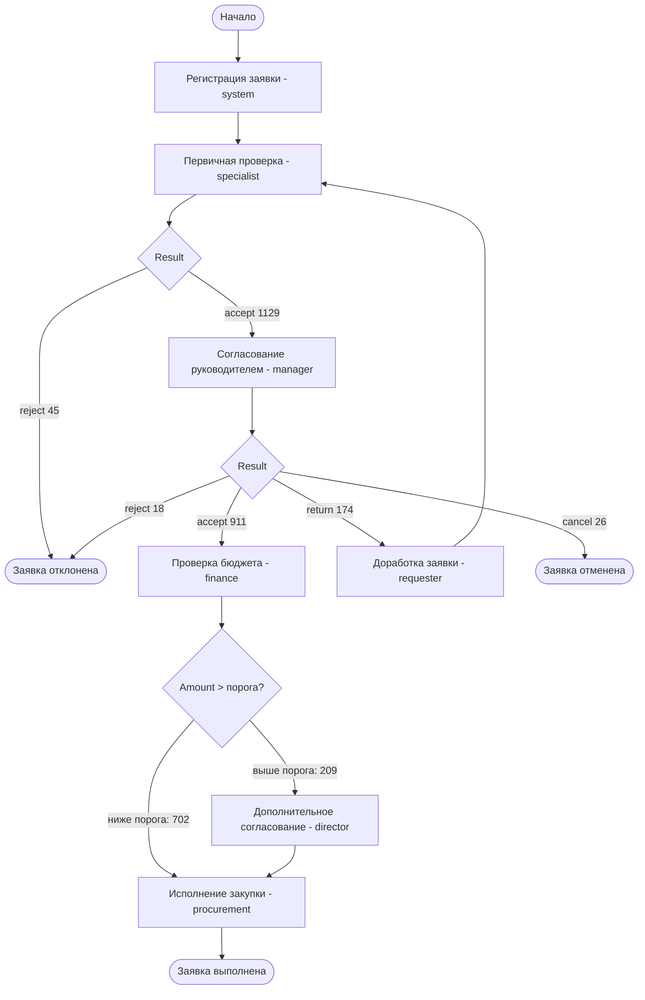

# Отчёт: Восстановление процесса закупки по журналу событий

## 1. Схема

Схема восстановленного процесса в формате Mermaid

**Легенда:**
- **Овал** — граница экземпляра (начало / окончание).
- **Прямоугольник** — активность; через дефис указана фактическая роль исполнителя (`system` — автоматическое действие).
- **Ромб** — наблюдаемая развилка; числа на исходящих стрелках — количество наблюдаемых переходов за журнал (1000 экземпляров всего).
- **Развилка `Amount`**: данные фиксируют порог в открытом интервале `(149 743.41; 150 614.59)`. Все 702 экземпляра без доп. согласования имеют сумму ≤ 149 743.41, все 209 с доп. — ≥ 150 614.59. Точное значение по журналу определить неполучится.
- **Развилки `Result`**: значения `accept`/`reject`/`return`/`cancel` — фактические бизнес-результаты задач, зафиксированные в журнале.
- **Цикл возврата**: `Согласование → Доработка → Первичная проверка` — неограниченный цикл. В данных наблюдается максимум 2 повтора, существует ли строгое ограничение на количество по журналу определить невозможно.

---

## 2. Отчёт

**Метод и валидация**
Данные `students.csv` загружен через `pandas` (кодировка `utf-8-sig`, чтобы избежать BOM). Внутри экземпляра выполнена сортировка по числовому `EventIndex`, глобальный порядок — по `Timestamp` (ISO 8601, UTC+03:00).  Валидация: `EventId` уникален, `EventIndex` идёт строго по возрастанию с 1 без пропусков, все истории начинаются с `process_started` и завершаются `process_completed`, у задач `task_completed` заполнены `TaskId/UserId/Role/Result`, у системных событий — пустые. Связь `ActivityId ↔ ActivityName` строго один-к-одному, поэтому `ActivityName` можно использовать как ключ. Всего 1000 экземпляров, 6508 событий.

**Активности, начала и окончания**
Обнаружено 10 активностей. Начало всегда одно: `Регистрация заявки` (1000). Конец - окончание экземпляра с 3-мя вариантами: `Заявка выполнена` (911), `Заявка отклонена` (63) и `Заявка отменена` (26).

**Маршруты**

**Варианты (и основной маршрут).** Для каждого экземпляра склеены `ActivityName` в строку `Route` через ` > `, сохранив порядок по `EventIndex`. Сгруппированы одинаковые `Route`, посчитаны `NumberOfCases` и `Share = NumberOfCases / 1000`. Получилось 8 различных вариантов.
Основной маршрут — V1 (567 экз., 56.7%), определён как наиболее частый: `Регистрация заявки > Первичная проверка > Согласование руководителем > Проверка бюджета > Исполнение закупки > Заявка выполнена`.

**Необязательные действия.** Для каждой активности посчитаны: `Events` (сколько раз встречается в журнале) и `Instances` (в скольких экземплярах встречается хотя бы раз). Активность считается обязательной, если `Instances = 1000`, иначе — необязательной, и её доля = `Instances / 1000`. 
Результат:
- `Первичная проверка`, `Регистрация заявки` — 1000/1000, обязательны;
- `Согласование` — 955/1000 (не встречается у 45 отказов специалиста);
- `Проверка бюджета`, `Исполнение закупки` — 911/1000 (только успешные);
- `Дополнительное согласование` — 209/911 успешных (22.9%);
- `Доработка заявки` — 156/1000 (15.6%).

Следовательно для успешной заявки обязательны `Регистрация → Первичная проверка → Согласование → Проверка бюджета → Исполнение → Заявка выполнена`; `Доп. согласование` и `Доработка` — необязательны, каждая в своём классе случаев.

**Развилки.** Построиены пары соседних активностей (`NextActivityName = shift(-1)` внутри `ProcessInstanceId`, последняя строка каждого экземпляра отброшена). Активность, у которой больше одного преемника — это точка ветвления. 
Найдено три:
1. `Первичная проверка` — 2 преемника; определяется `Result`: `accept` (1129) и `reject` (45).
2. `Согласование руководителем` — 4 преемника; определяется `Result`: `accept` (911), `return` (174), `reject` (18) и `cancel` (26). 
3. `Проверка бюджета` — 2 преемника. Вероятная зависимость от `Amount`, по данным порог лежит в интервале `(149 743.41; 150 614.59)`.

**Возвраты **
Наблюдается цикл `Согласование (return) → Доработка → Первичная проверка`. Всего 156 экземпляров с возвратами: 138 — с одним повтором, 18 — с двумя. Три и более повторов в выборке отсутствуют, но зависит это от строгого ограничения или от выборки определить невозможно.

**Данные, подтверждающие выводы**
- Частоты переходов (DFG) полностью совпадают с `student_transitions.csv` (12 рёбер).
- Примеры ID: `1dfce731-...` (V1, базовый); `015bf5dd-...` (V3, 1 возврат без доп.); `009608ae-...` (V7, 2 возврата); `08a60c66-...` (V4, отказ специалиста); `00e3854b-...` (V5, отмена менеджером).

**Данные и гипотезы**
- **Порог `Amount`**: в 911 успешных экземплярах доп. согласование назначается только, когда сумма лежит выше границы. Все 209 экземпляров с доп. согласованием имеют `Amount ≥ 150 614.59`; все 702 без него — `Amount ≤ 149 743.41`. Внутри интервала `(149 743.41; 150 614.59)` нет ни одного наблюдения. Другие проверяемые пороги не подошли (100 тыс. и 200 тыс.)
- **Длина цикла**: максимальное число повторов в выборке — 2. По данным нельзя утверждать, что процесс запрещает 3+ повторов

**Ограничения и роль AI**
Журнал содержит только наблюдаемые события: внутренние условия gateway-шлюзов в выгрузке отсутствуют. 
AI использовался для генерации кода. Все числа, частоты и пороговые значения получены кодом на полном CSV (ячейки 1–5). Гипотеза о пороге около 150 тыс. `Amount` проверена перебором.

---

## 3. Код

Работа с данными была через `Data.ipynb`, содержащий следующие ячейки:
1. Загрузка и типизация данных.
2. Валидация.
3. Построение профиля экземпляров и активностей.
4. Построение графа переходов и сохранение `student_transitions.csv`.
5a и 5b. Анализ развилок, поиск порога `Amount`, сборка вариантов.
6a и 6b. Сравнение с Process Mining (PM4Py).

Запуск: `pip install pandas numpy matplotlib pm4py scikit-learn` (pm4py и scikit-learn для ячейки 6), все ячейки выполняются последовательно.

---

## 4. Сравнение с автоматической моделью

Использованы Process Mining и Decision  Mining (дерево). Получено:
- **Ориентированный граф** из 12 рёбер. Они с `student_transitions.csv`, что подтверждает правильность выделения пар.
- **Petri net**: 12 мест, 16 переходов. 
- **Fitness**: **1.0** (100% fitting traces). 
- **Precision**: **0.66**. Около 34% поведения, которое допускает модель, не наблюдалось в журнале.

**Ошибки модели**.  
Inductive Miner допустил параллельность после `Регистрация заявки`. Он позволяет чередовать `Первичную проверку` и `Согласование`: модель разрешает маршрут `Регистрация → Согласование → Первичная проверка → …`, хотя в журнале порядок всегда строгий (`Проверка` всегда перед `Согласованием`). Также оба цикла не имеют счётчика итераций — модель разрешает 3+ повторов, хотя в журнале максимум 2. 

**Проверка бюджета**. Дерево разделяет 911 экземпляров по Amount с accuracy = 1.0000. Выбран оптимальный разрез 150179 — середина интервала (149 743.41; 150 614.59). Это формальное подтверждение, что выбор «доп. согласование / сразу исполнение» определяется только суммой. Точное бизнес-значение из данных не выводится.

**Согласование руководителем**. Дерево по Amount для 955 экземпляров даёт accuracy = 0.7906, что точно совпадает с долей мажоритарного класса: 755 / 955 = 0.7906. Значит дерево предсказывает `accept` для всех экземпляров независимо от суммы.

